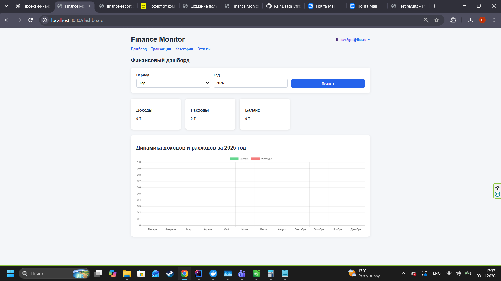
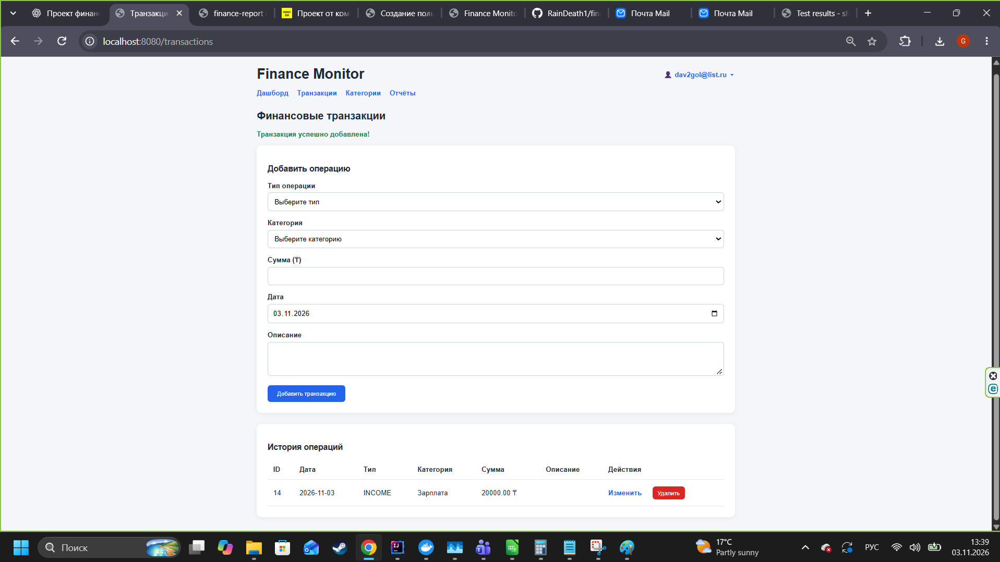
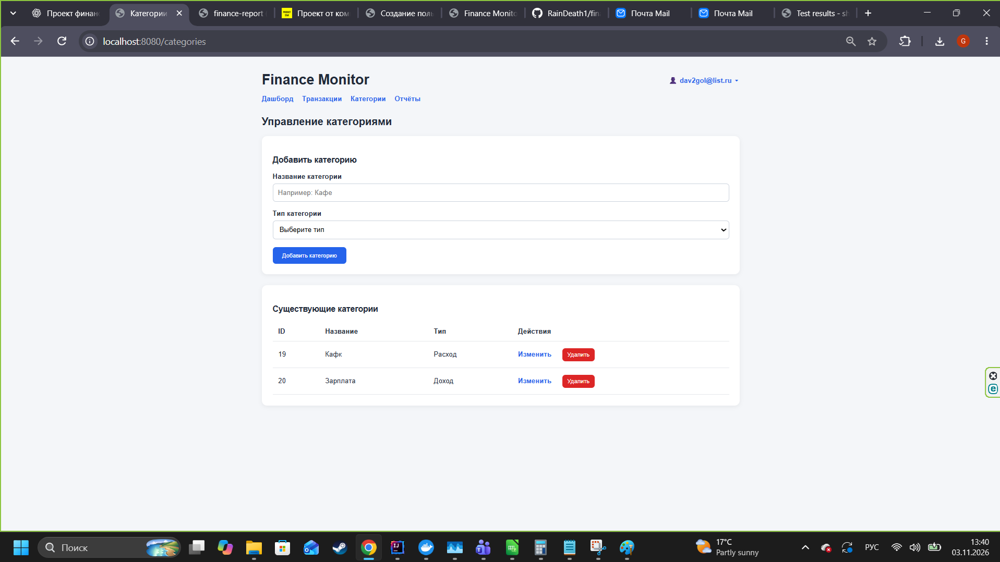
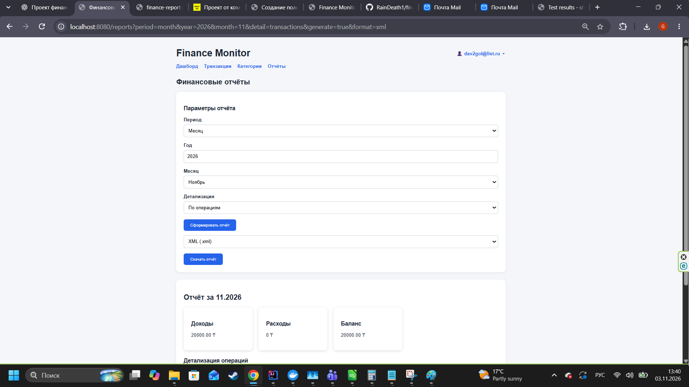
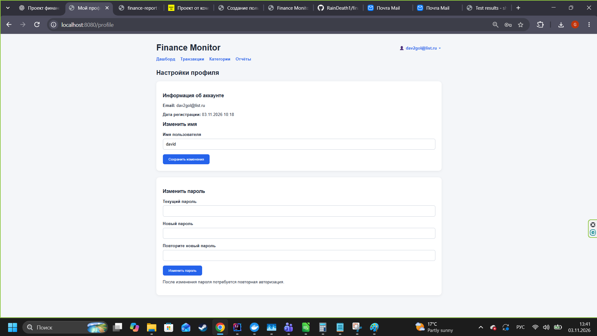

# Finance Monitor

**Finance Monitor** — веб-приложение для учёта личных финансов, анализа доходов и расходов и формирования отчётов. Проект разработан в рамках практического задания **Globus IT**.

Пользователь может создавать категории и транзакции, просматривать финансовые показатели за выбранный период, анализировать динамику операций и экспортировать отчёты в PDF, Excel и XML.

## Возможности

- **Учёт транзакций:** добавление, просмотр, редактирование и удаление доходов и расходов.
- **Категории:** создание, просмотр, редактирование и удаление категорий доходов и расходов.
- **Дашборд:** доходы, расходы, баланс и диаграммы по дням или месяцам (Chart.js).
- **Отчётность:** выбор периода (месяц, квартал, год и дополнительные варианты), детализация операций и предварительный просмотр.
- **Экспорт:** PDF, XLSX и XML.
- **Учётные записи:** регистрация, подтверждение email, вход, восстановление и смена пароля, редактирование имени пользователя.
- **Администрирование:** управление пользователями и журнал административных действий.
- **Изоляция данных:** операции и отчёты ограничены данными текущего авторизованного пользователя.
- **Обработка ошибок:** пользовательские страницы 403, 404 и 500.

## Технологии

| Компонент | Технологии |
| --- | --- |
| Язык | Java 21 |
| Backend | Spring Boot, Spring MVC, Spring Security |
| Работа с данными | Spring Data JPA, Hibernate, Spring JDBC |
| База данных | PostgreSQL |
| Веб-интерфейс | Thymeleaf, HTML5, CSS3, JavaScript |
| Графики | Chart.js |
| Экспорт Excel | Apache POI |
| Экспорт PDF | PDF-генератор, подключённый в проекте |
| Сборка | Gradle Wrapper |
| Тестирование | JUnit 5, Mockito, MockMvc |
| Локальная инфраструктура | Docker Desktop, PostgreSQL, Mailpit (для тестов почты) |

## Архитектура

```text
Браузер пользователя
   |
   | HTML-страницы / формы / JavaScript
   v
Spring MVC Controllers -----> Thymeleaf Templates
   |
   v
Service Layer
   |-- Транзакции и категории
   |-- Финансовая аналитика
   |-- Отчётность и экспорт
   |-- Пользователи и безопасность
   |
   +----> Spring Data JPA / Hibernate ----> PostgreSQL
   |
   +----> Spring JDBC --------------------> PostgreSQL
   |
   +----> SMTP ---------------------------> Почтовый сервер

REST API <---- HTTP Basic / Spring Security
```

**Примечание:** интерфейс реализован на серверных шаблонах Thymeleaf с дополнительным JavaScript; Angular и React не используются.

## Требования для локального запуска

- JDK 21;
- Docker Desktop с работающим Docker Engine;
- PostgreSQL (для локального запуска используется контейнер `finance-postgres`);
- доступ к параметрам подключения к БД;
- SMTP-сервер для проверки email (локально можно использовать Mailpit; для реальной отправки настроен отдельный SMTP-профиль).

Gradle устанавливать отдельно не требуется: проект содержит Gradle Wrapper (`gradlew.bat` и `gradlew`).

## Локальный запуск

### 1. Подготовить PostgreSQL

Если контейнер PostgreSQL уже создан, запустите его:

```powershell
docker start finance-postgres
```

Для существующей локальной БД можно проверить доступность:

```powershell
docker exec finance-postgres pg_isready -U admin -d finance_db
```

Для нового окружения создайте PostgreSQL с теми же параметрами подключения, которые указаны в конфигурации приложения. **Не размещайте реальные пароли в README или Git.**

### 2. Настроить приложение

Проверьте `src/main/resources/application.properties` и, при использовании реальной почты, `src/main/resources/application-smtp.properties`.

Настройте подключение к PostgreSQL и необходимые переменные окружения **согласно используемым в этих файлах именам**. Секреты храните только локально или в переменных окружения.

Для SMTP-профиля в локальной конфигурации IntelliJ IDEA используются переменные:

```text
SPRING_PROFILES_ACTIVE=smtp
MAIL_USERNAME=<почтовый_адрес>
MAIL_PASSWORD=<пароль_приложения>
```

При использовании Gmail для SMTP нужен пароль приложения, а не пароль входа в Google-аккаунт. Настройки почтового профиля должны соответствовать фактической конфигурации проекта.

**Важно:** `.env` не загружается автоматически стандартной командой Gradle. В IntelliJ IDEA для запуска используется конфигурация с EnvFile. При запуске из терминала переменные окружения необходимо передать процессу отдельно.

### 3. Запустить приложение

**Windows / PowerShell:**

```powershell
.\gradlew.bat bootRun
```

Если среда настроена через IntelliJ IDEA, можно использовать существующую Run Configuration `FinanceMonitorApplication`.

После успешного запуска открыть **http://localhost:8080**.

### 4. Локальная проверка почты (опционально)

Для тестирования без отправки писем внешним получателям можно использовать контейнер `finance-mailpit`:

```powershell
docker start finance-mailpit
```

Веб-интерфейс Mailpit: **http://localhost:8025**. При этом приложение должно использовать соответствующие настройки SMTP для Mailpit, а не внешний профиль.

## Основные страницы

| URL | Назначение |
| --- | --- |
| `/register` | Регистрация |
| `/login` | Вход |
| `/verify-email` | Подтверждение электронной почты |
| `/forgot-password` | Запрос восстановления пароля |
| `/reset-password` | Установка нового пароля по ссылке |
| `/dashboard` | Финансовый дашборд |
| `/transactions` | Управление транзакциями |
| `/categories` | Управление категориями |
| `/reports` | Просмотр и экспорт отчётов |
| `/profile` | Настройки профиля |
| `/admin` | Панель администратора (роль `ADMIN`) |

## REST API

| Метод | URL | Назначение |
| --- | --- | --- |
| `GET` | `/api/transactions` | Список транзакций текущего пользователя |
| `POST` | `/api/transactions` | Добавление транзакции |
| `GET` | `/api/analytics/metrics` | Финансовые показатели |
| `GET` | `/api/reports/export` | Экспорт отчёта |

API защищён средствами Spring Security. Для API используется HTTP Basic; веб-страницы используют обычную форму входа.

Пример параметров экспорта:

```text
GET /api/reports/export?period=month&year=2026&month=11&format=pdf&detail=transactions
```

Для `format` поддерживаются `pdf`, `xlsx` и `xml`. Кроме API-маршрута, в интерфейсе используются существующие маршруты скачивания `/reports/export` и `/reports/export/xml`.

## Запуск тестов

Все тесты:

```powershell
.\gradlew.bat cleanTest test
```

Отдельный тестовый класс:

```powershell
.\gradlew.bat test --tests "com.globus.finance.controller.report.ReportExportControllerTest"
```

Тестовые классы, проверенные в ходе разработки:

- `EmailVerificationServiceTest`;
- `PasswordResetServiceTest`;
- `TransactionServiceTest`;
- `AnalyticsServiceTest`;
- `TransactionRestControllerTest`;
- `AnalyticsRestControllerTest`;
- `ReportExportControllerTest`;
- `ProfileServiceTest`;
- `ProfileControllerTest`.

Отчёт Gradle о тестах находится в `build/reports/tests/test/index.html`.

## Скриншоты

Добавьте скриншоты интерфейса в каталог `docs/screenshots/`:

```text
docs/
  screenshots/
    dashboard.png
    transactions.png
    categories.png
    reports.png
    profile.png
```

После добавления файлов они будут отображаться прямо в README:

**Дашборд**



**Транзакции**



**Категории**



**Отчёты**



**Профиль**



## Безопасность

- Пароли хранятся в виде хешей, не в открытом виде.
- Для регистрации требуется подтверждение email.
- Восстановление пароля выполняется через одноразовую ссылку с ограниченным сроком действия.
- Предусмотрены ограничения повторных запросов восстановления.
- Изменение пароля инвалидирует прежние сессии через `sessionVersion`.
- Доступ к административным разделам ограничен ролью `ADMIN`.
- Данные транзакций, категорий и отчётов привязаны к авторизованному пользователю.

## Статус проекта

**Реализовано и проверено локально:** основные финансовые операции, аналитика, страницы отчётов, экспорт в PDF/Excel/XML, авторизация и подтверждение почты, профиль пользователя, основные автоматические тесты, пользовательские страницы ошибок.

**Остаётся до итоговой сдачи:** сохранить скриншоты в репозитории, проверить мобильную адаптивность, подготовить облачное окружение и выполнить демонстрацию после развёртывания.

> Примечание для развёртывания: внешняя почта и ссылки подтверждения должны использовать публичный адрес приложения вместо `localhost`. Учётные данные и другие секреты должны передаваться через переменные окружения или безопасное хранилище секретов.
